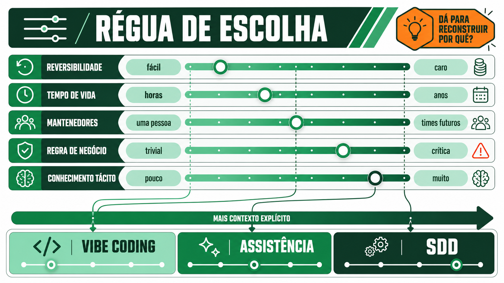

# Modos de trabalho com IA

Um time que adota IA no desenvolvimento costuma trabalhar em três modos ao mesmo tempo, sem dar nome a nenhum deles. Esta página nomeia os três, conta de onde veio o mais recente e termina com o critério para escolher um modo por tarefa.

## Os três modos

O terceiro modo, **SDD**, é desenvolvimento guiado por especificação, e a Sessão 10 o cobre por inteiro.

| Modo                       | Forma de trabalho                                                                        | Como a qualidade é julgada                                | Risco dominante                                    |
| -------------------------- | ---------------------------------------------------------------------------------------- | --------------------------------------------------------- | -------------------------------------------------- |
| Vibe coding                | conversa corrente e resultado aparente                                                   | "parece funcionar"                                        | intenção implícita, regressão, dívida invisível    |
| Assistência de codificação | tarefa pontual, código existente, revisão do desenvolvedor                               | testes e revisão depois de gerar                          | contexto fragmentado, decisões não registradas     |
| SDD (Sessão 10)             | constituição, spec (especificação), plano, tarefas, testes, revisões e barreiras formais | rastreabilidade entre intenção, implementação e evidência | custo de especificar sem manter os artefatos vivos |

Este workshop move o time da primeira linha para a terceira ao longo de dez sessões: os Blocos 2 e 3 praticam assistência de codificação disciplinada, e a Sessão 10 executa o SDD completo.

## De onde vem o termo *vibe coding*

O termo vem de [Andrej Karpathy](../referencia/bibliografia.md#karpathy-software-is-changing-again-2025), pesquisador fundador da OpenAI e ex-diretor de IA da Tesla, numa publicação de fevereiro de 2025. O motivo técnico para essa prática funcionar já existia antes do nome: [Brown et al.](../referencia/bibliografia.md#brown-et-al-language-models-are-few-shot-learners-2020) demonstraram, no artigo que apresentou o GPT-3, que um modelo de linguagem executa uma tarefa nova a partir só da descrição em linguagem natural e de alguns exemplos no próprio texto de entrada, sem qualquer ajuste de peso. Esse mecanismo se chama aprendizado em contexto, e é a razão pela qual um prompt funciona como programa.

[Simon Willison](../referencia/bibliografia.md#willison-what-is-agentic-engineering-2026), que documenta práticas de desenvolvimento assistido por IA desde 2022, é específico sobre onde o uso legítimo do vibe coding termina: "vibe coding is more useful in its original definition — we need a term to describe unreviewed, prototype-quality LLM-generated code". Esse uso serve para prototipagem descartável, e o problema começa quando o time passa da fase de protótipo para a de produto sem perceber. Nessa passagem, as decisões tomadas na conversa não chegam ao repositório, o teste confirma apenas o que já foi implementado e a sessão seguinte do agente não herda o raciocínio da anterior.

O próprio [Karpathy](../referencia/bibliografia.md#karpathy-software-is-changing-again-2025) documentou o limite na prática: os ganhos de velocidade do vibe coding "vanished shortly after getting local code running". A aceleração desaparece quando o código precisa ser integrado a outros sistemas, receber manutenção ou tratar um caso de borda que o prompt original não previu.

## Quando cada modo se justifica

Trate os três modos acima como famílias de risco, sem uma ordem de maturidade que todo código precise percorrer. Diante de uma tarefa, pergunte que risco ela carrega, porque a resposta muda de tarefa para tarefa dentro do mesmo time.

| Critério                             | Favorece *vibe coding*     | Favorece assistência de codificação | Favorece SDD                                       |
| ------------------------------------ | -------------------------- | ----------------------------------- | -------------------------------------------------- |
| Reversibilidade                      | fácil de descartar         | custo médio de retrabalho           | difícil ou caro de desfazer                        |
| Tempo de vida esperado               | horas, um experimento      | semanas, uma feature                | meses ou anos, parte do produto                    |
| Quantas pessoas vão mexer depois     | só quem escreveu           | o time atual                        | times futuros, sem contexto da decisão original    |
| Regra de negócio envolvida           | nenhuma, ou trivial        | alguma, conhecida pelo time         | crítica, com exceções que um prompt vago esquece   |
| Familiaridade com o código existente | código novo, sem histórico | sistema conhecido pelo time atual   | sistema grande e maduro, com convenções implícitas |

A pergunta que resume a tabela: se esse código quebrar em produção, alguém vai conseguir reconstruir por que ele foi escrito daquele jeito? A resposta depende do registro que cada modo deixa: o vibe coding não deixa registro da intenção, a assistência de codificação deixa o código e o ticket, e o SDD deixa a especificação completa.

!!! tip "Aplique agora"  
    Pense numa tarefa real do seu backlog desta semana. Percorra as cinco linhas da tabela e classifique-a: ela puxa para vibe coding, assistência ou SDD? Compare com a pessoa ao lado. Vocês chegaram no mesmo modo para tarefas parecidas?

## O peso econômico de reversibilidade e tempo de vida

[Boehm, em *Software Engineering Economics* (1981)](../referencia/bibliografia.md#boehm-software-engineering-economics-1981), documentou algo que antecede qualquer LLM: o custo de corrigir um defeito cresce a cada fase do desenvolvimento. Em sistemas pequenos, o crescimento é suave. Em sistemas grandes e críticos, um problema descoberto depois da entrega pode custar da ordem de 100 vezes mais para corrigir do que o mesmo problema pego na fase de requisitos. A proporção exata varia por contexto (pesquisa mais recente questiona se o multiplicador de Boehm ainda vale em times ágeis com integração contínua), mas a direção não mudou em quatro décadas: quanto mais tarde uma ambiguidade aparece, mais caro fica resolvê-la.

Essa lógica sustenta as duas primeiras linhas da tabela de critérios. No vibe coding, a ambiguidade costuma aparecer só quando o código já está em produção. O SDD exige que ela apareça na especificação, fase em que a correção ainda custa pouco.

## Anti-padrão: *vibe coding* tratado como produto

O uso de vibe coding é legítimo, e o anti-padrão aparece quando o time usa esse modo e depois esquece que o usou. Os sintomas seguem sempre a mesma ordem: o protótipo funciona na demonstração, alguém decide "já está pronto, só falta subir", ninguém escreve a especificação que existia apenas na cabeça de quem conversou com o agente, e o próximo bug exige uma investigação completa, porque faltam teste, decisão registrada e alguém que lembre por que aquele caso de borda foi ignorado.

Para evitar isso, decida o modo antes de começar, enquanto nenhuma outra equipe depende do protótipo. Essa decisão reduz o risco mais do que uma proibição geral de vibe coding, que impediria também o uso legítimo em protótipos descartáveis.

### Dívida de intenção

Quando isso acontece, o time acumula um problema de outro tipo. Dívida técnica é código que funciona e que alguém sabe como melhorar, com um caminho conhecido e custo estimável entre o que está lá e o que deveria estar.

Um protótipo promovido a produto acumula **dívida de intenção**. O sistema fica cheio de decisões que ninguém consegue distinguir de acidente de implementação. Aquele desconto que não se aplica a pedidos acima de um valor é regra de negócio acordada com o cliente, restrição técnica de uma integração, ou consequência não intencional da ordem em que as condições foram escritas? Sem a resposta, nenhuma alteração é segura: mudar o comportamento pode quebrar uma regra que ninguém sabia que existia, e mantê-lo pode preservar um defeito que a equipe já trata como regra.

As duas dívidas exigem trabalhos de tipo diferente. A dívida técnica se resolve com refatoração, que é trabalho de engenharia. A dívida de intenção exige reconstruir a decisão original, muitas vezes entrevistando pessoas que já saíram da empresa. Quando a decisão original se perdeu, o time escolhe de novo sem saber o que a primeira escolha levava em conta.

A [Sessão 10](../sessao-10-sdd-ciclo-completo/index.md) trata do ciclo que evita essa dívida, mantendo intenção, decisão e evidência ligadas ao código.

**Próxima página:** [Evidência empírica de produtividade](evidencia-empirica.md).
