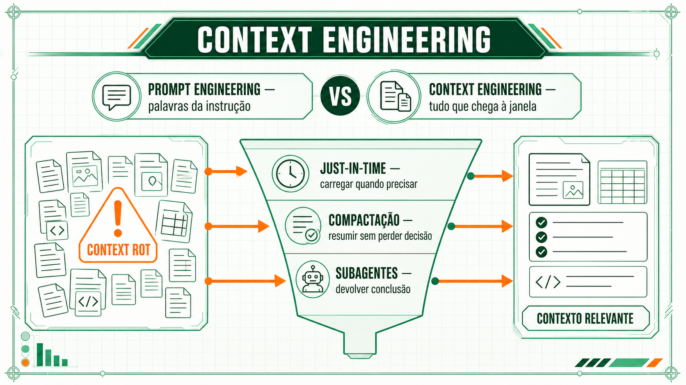

# Engenharia de contexto

Preparar o que entra na janela de contexto de um agente é um problema maior do que escrever um bom prompt. Esta página descreve o que mudou de escopo e o que essa mudança exige de quem configura o ambiente do time.

A [Anthropic, no guia de engenharia "Effective context engineering for AI agents"](../referencia/bibliografia.md#anthropic-effective-context-engineering-2025) (setembro de 2025), descreve uma mudança de foco. Durante alguns anos a atenção ficou na engenharia de prompt (*prompt engineering*), que é encontrar as palavras certas para uma instrução. A pergunta que passou a decidir o resultado é outra: que configuração de contexto tem mais chance de produzir o comportamento que você quer. A engenharia de contexto (*context engineering*) inclui o texto da instrução e trata de tudo que chega à janela numa execução: instruções, histórico, resultados de ferramentas, arquivos lidos.

O guia é específico sobre o papel das ferramentas nessa mudança. Elas formam o contrato entre o agente e tudo que ele pode consultar ou fazer, e precisam ser desenhadas com economia de token em mente. Uma ferramenta mal desenhada ocupa espaço de contexto que poderia estar guardando informação útil ao problema, além de ser mais incômoda de usar.

Existe um motivo técnico para a engenharia de contexto ter se tornado o problema central, e ele está na própria arquitetura Transformer, apresentada por [Vaswani et al. (2017)](../referencia/bibliografia.md#vaswani-et-al-attention-is-all-you-need-2017) e já citada na Sessão 1: a atenção entre tokens cresce de forma quadrática com o tamanho do contexto. Quanto mais token na janela, mais relações de atenção o modelo precisa distribuir entre eles, e sua capacidade de recuperar com precisão uma informação específica cai de forma gradual conforme o contexto cresce. A própria Anthropic chama esse efeito de degradação de contexto (*context rot*).

O guia recomenda duas técnicas concretas contra essa degradação. A primeira é recuperação just-in-time: o agente mantém referências leves (caminho de arquivo, consulta salva, link) e usa ferramentas para carregar o conteúdo completo só no momento em que precisa dele, sem pré-carregar todo dado relevante antes de começar. O Claude Code opera assim: escreve uma consulta direcionada e usa ferramentas de linha de comando para vasculhar uma base de código inteira sem carregar cada arquivo na janela de contexto de uma vez. A segunda é compactação: numa tarefa de muitas etapas, o agente resume o histórico de conversa com alta fidelidade antes de continuar, mantendo o que importa. Ao compactar, garanta primeiro que nada importante se perdeu, e só depois corte o que sobrou de irrelevante.

Uma terceira técnica resolve o problema pela arquitetura, com sub-agentes de contexto isolado. Um agente principal delega uma exploração extensa, por exemplo varrer um repositório grande atrás da causa de um bug, para um sub-agente, que devolve um resumo condensado, muitas vezes na casa de 1 a 2 mil tokens, e o agente principal recebe só essa conclusão, sem o histórico da exploração.

O mesmo raciocínio vale para a instrução que configura o agente, seja um prompt de sistema ou um arquivo como o AGENTS.md discutido adiante: o guia chama de altitude certa o ponto entre dois extremos. Instrução específica demais deixa de servir quando a tarefa sai um pouco do previsto, e instrução genérica demais não altera nenhuma decisão do agente. Na altitude certa, a instrução guia o comportamento e ainda deixa o modelo aplicar critério nos casos que ela não previu.

**Próxima página:** [MCP e ferramentas externas](mcp.md).
