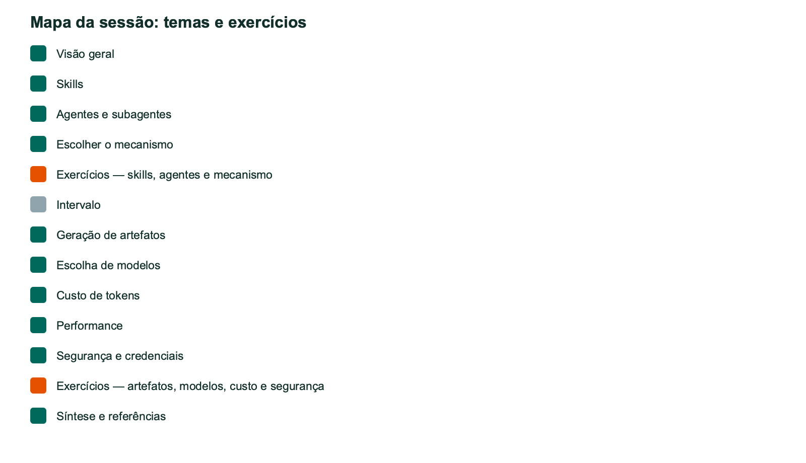

# S8 — Skills e agentes

**Bloco:** 4 — Automação, qualidade e integração

> **Pergunta-guia:** o que uma skill ou um agente precisa declarar antes de ser construído para que o custo, a segurança e o resultado possam ser conferidos depois?

## Problema

As sessões anteriores usaram o agente como ferramenta de uso individual. A partir desta sessão, a equipe passa a construir as próprias ferramentas: skills que ensinam o agente a executar uma tarefa recorrente do mesmo modo e agentes que recebem uma parte do trabalho com contexto, modelo e permissões próprios. Quando essa construção é feita por tentativa e erro, o custo de tokens aparece só na fatura, o modelo é escolhido por hábito, o desempenho é medido pela impressão de quem usa, e as credenciais e as permissões do agente ficam implícitas.

## A ficha de requisitos

A resposta à pergunta-guia é uma ficha de requisitos, uma tabela com uma linha para cada decisão que a skill ou o agente declara antes da construção. Cada página de teoria preenche uma ou duas linhas e termina com o bloco "Linha da ficha", que lista as perguntas daquela linha, e os exercícios aplicam essas decisões à construção e à avaliação de uma skill.

A ficha existe para que as decisões fiquem escritas antes do primeiro teste. Uma skill criada sem ela costuma esconder escolhas que só aparecem depois, como o modelo herdado da conversa, a ferramenta que o subagente herda sem que ninguém a tenha escolhido ou a credencial pessoal que o agente passa a usar.

## Mapa da sessão

A sessão alterna teoria e dois blocos de exercícios. O primeiro aplica skills, subagentes e escolha do mecanismo; o segundo cria e mede uma skill após o estudo de artefatos, modelos, custo, performance e segurança.

| Página | Linha da ficha que preenche |
|---|---|
| [Skills](skills.md) | Arquivo e front-matter da skill |
| [Agentes e subagentes](agentes-e-subagentes.md) | Arquivo e front-matter do subagente |
| [Escolher o mecanismo](escolher-o-mecanismo.md) | Mecanismo |
| [Geração de artefatos](geracao-de-artefatos.md) | Artefato e conferência |
| [Escolha de modelos](escolha-de-modelos.md) | Modelo e esforço |
| [Custo de tokens](custo-de-tokens.md) | Orçamento de tokens |
| [Performance](performance.md) | Tempo |
| [Segurança e credenciais](seguranca-e-credenciais.md) | Ferramentas e permissões, e identidade, credencial e cofre |
| [Exercícios — artefatos, modelos, custo e segurança](oficina-de-ferramentas.md) | Construção e medição da skill |
| [Exercícios — skills, agentes e escolha do mecanismo](exercicios.md) | Criação e restrição de ferramentas |

## Como usar este material

Estas páginas apoiam uma sessão conduzida ao vivo, sem leitura prévia obrigatória. O roteiro abaixo apresenta a sequência dos temas e das atividades. A sessão pressupõe o ambiente configurado nas Sessões 1 e 2 e o uso do Claude Code, e as notas "Claude Code e Codex CLI" das páginas indicam o equivalente no Codex CLI quando a documentação o descreve.

!!! info "Versões verificadas"
    A versão instalada em cada máquina aparece nos comandos `claude --version` e `codex --version`. As observações foram feitas em 23/10/2026 com `claude 2.1.309` e `codex-cli 0.140.0`, e o comando `codex doctor` informa a versão 0.164.0 como disponível. O modelo padrão da conta exigiu uma versão mais nova do Codex e os demais modelos do catálogo foram recusados com conta ChatGPT, de modo que nenhum agente do Codex foi executado e as linhas de subagente do Codex têm o status documentado.

As páginas marcam cada afirmação de comportamento como observada, quando foi executada nas versões acima, documentada, quando vem da página oficial lida sem execução, ou não confirmada, quando a documentação lida não cobre o item. Os números citados nas páginas de teoria vêm das fontes listadas na [bibliografia do curso](../referencia/bibliografia.md), que descrevem o comportamento documentado pela Anthropic, pela OpenAI e pela especificação aberta Agent Skills. Nomes de modelos, preços e limites mudam com frequência, e a equipe confere a documentação vigente antes de decidir, a partir do estado documentado em 22/10/2026 para as páginas originais e em 23/10/2026 para o front-matter e o Codex CLI.

## Objetivos de aprendizagem

Ao final desta sessão, o participante deve ser capaz de:

1. **Distinguir** skill, subagente, skill com fork, hook e arquivo de instrução e escolher o mecanismo adequado a uma tarefa.
2. **Escrever** o front-matter e o corpo de uma skill e o arquivo de um subagente, com campos e valores válidos, e diagnosticar o arquivo que falha em silêncio.
3. **Declarar** os requisitos funcionais e não funcionais de uma skill ou de um agente na ficha: artefato produzido, modelo, orçamento de tokens, tempo, permissões e credenciais.
4. **Estimar** o efeito do cache de prompt e da escolha do modelo sobre o custo de uma tarefa repetida.
5. **Aplicar** os cuidados com credenciais: identidade própria do agente, token com escopo mínimo e validade curta, armazenamento fora do repositório e rodízio.
6. **Conferir** o artefato gerado por um agente por meio de script e de critérios declarados antes da construção.
7. **Localizar** o equivalente de um recurso do Claude Code no Codex CLI e reconhecer quando não há equivalente documentado.

## Roteiro da sessão

| Página ou atividade | Foco |
|---|---|
| Visão geral | Pergunta-guia e ficha |
| [Skills](skills.md) | Front-matter, descrição e níveis de carga |
| [Agentes e subagentes](agentes-e-subagentes.md) | Contexto isolado e ferramentas |
| [Escolher o mecanismo](escolher-o-mecanismo.md) | Critérios de escolha |
| [Exercícios — skills, agentes e escolha do mecanismo](exercicios.md) | Exercício 1 e teste de restrição do exercício 5 |
| Intervalo | |
| [Geração de artefatos](geracao-de-artefatos.md) | Conferência estrutural e humana |
| [Escolha de modelos](escolha-de-modelos.md) | Capacidade, custo e esforço |
| [Custo de tokens](custo-de-tokens.md) | Cache e medição |
| [Performance](performance.md) | Medidas de desempenho |
| [Segurança e credenciais](seguranca-e-credenciais.md) | Permissões e identidade |
| [Exercícios — artefatos, modelos, custo e segurança](oficina-de-ferramentas.md) | Criar, conferir e medir a skill |
| [Experimentos complementares](experimentos-complementares.md) | Práticas opcionais para depois da sessão |
| [Síntese e referências](sintese-e-referencias.md) | Checklist e autoavaliação |

## Como conduzir

Cada página de teoria apresenta um tema, termina com o bloco "Linha da ficha" e traz tabelas de decisão que os exercícios reutilizam. O instrutor apresenta o tema e não precisa percorrer as tabelas linha a linha, porque elas ficam à disposição da turma durante a prática.

O segundo bloco de exercícios usa a skill `identificando-tarefas-e-riscos`, que gera um relatório de tarefas e riscos a partir de uma transcrição de reunião para a ACME, uma universidade fictícia. O exemplo foi escolhido porque o artefato tem estrutura verificável por script e conteúdo que só uma pessoa confere, o que permite discutir as duas formas de conferência.

As equipes são formadas antes da sessão. Cada pessoa executa o segundo bloco de exercícios no próprio computador, numa pasta vazia, e nenhuma credencial real é usada: os exercícios de segurança trabalham com descrições e com tokens fictícios.

!!! warning "Limite desta sessão"
    Os números de custo, de ganho de desempenho e de consumo de tokens vêm de documentação e de relatos da própria Anthropic, medidos em tarefas e configurações específicas. Nenhum deles mede as tarefas da equipe. A decisão de adotar uma skill ou um agente depende da medição feita nos exercícios, com as tarefas e os modelos da própria equipe.

**Próxima página:** [Skills](skills.md).
