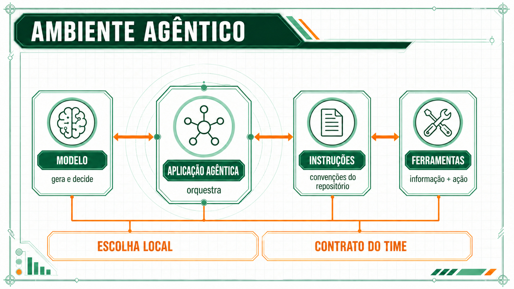

# Práticas do curso e o uso de agentes nas empresas

Esta página retoma as práticas que a equipe construiu nas Sessões 1 a 9 e compara cada uma delas com o que empresas, consultorias e pesquisadores publicaram sobre o uso de agentes de IA ao longo de 2026. Um agente de IA, neste curso, é um sistema que recebe um objetivo, escolhe por conta própria os passos para atingi-lo, usa ferramentas como leitura de arquivos e chamadas a outros sistemas e confere o resultado de cada passo antes do seguinte. A comparação segue a ordem do curso, e cada afirmação sobre o mercado traz a fonte que a sustenta.

![Diagrama com cinco linhas. À esquerda, as práticas do curso: modo de trabalho, arnês e ambiente compartilhado nas Sessões 1 e 2, especificação, regras de negócio e teste antes do código nas Sessões 3 a 6, conferência da resposta contra uma fonte na Sessão 7, ficha de requisitos, custo e identidade do agente na Sessão 8, e regras para compartilhar skills entre colegas na Sessão 9. À direita, ligada por uma seta a cada prática, a mudança observada no mercado em 2026: plataformas que controlam a execução de agentes de programação, segundo o Gartner, pessoas que especificam e revisam enquanto agentes alteram o código, segundo a Cognition, medida pelo resultado aceito pelo processo, segundo a McKinsey, identidade própria para cada agente, segundo Gartner, Microsoft e Forrester, e revisão de skills antes da distribuição interna, segundo o Nubank e a OWASP.](assets/praticas-do-curso-e-mercado.png)

## Ponto de partida da equipe na Sessão 1

A Sessão 1 começou com uma constatação: a equipe já usava IA todos os dias, e o resultado variava muito de uma pessoa para outra e de uma tarefa para outra. A explicação apresentada naquela sessão foi a diferença entre três modos de trabalho. No vibe coding, a pessoa pede código sem especificar o comportamento esperado e aceita o que parece funcionar. Na assistência de codificação, a pessoa pede ajuda pontual sobre um código que já existe e revisa a sugestão. No desenvolvimento guiado por especificação, chamado de SDD, a pessoa escreve antes o que o código precisa fazer e só depois aciona o agente.

A Sessão 1 também apresentou o [experimento do METR de 2025](../referencia/bibliografia.md#metr-experienced-developer-productivity-2025), em que desenvolvedores experientes levaram 19% mais tempo para concluir tarefas com IA em projetos que já conheciam, embora acreditassem ter ficado 20% mais rápidos. Em fevereiro de 2026, o METR, organização independente que mede a capacidade de modelos de IA, [revisou o alcance desse resultado](../referencia/bibliografia.md#metr-mudanca-no-desenho-do-experimento-de-produtividade-2026): a nova rodada do experimento apresentou problemas na seleção dos participantes e na medição, e o número de 2025 passou a valer apenas para as ferramentas e os desenvolvedores estudados naquele ano. A revisão mantém a lição da Sessão 1, de que a percepção de ganho de quem usa a ferramenta não substitui a medição.

Ao longo de 2026, a pergunta que as empresas faziam mudou de "a IA ajuda o desenvolvedor?" para "quanto trabalho é possível entregar a um agente, e com que controle?". A pesquisa [The State of AI in 2026](../referencia/bibliografia.md#mckinsey-the-state-of-ai-in-2026-2026), publicada pela consultoria McKinsey em agosto de 2026 com 1.719 participantes de 97 países, registrou que 40% dos respondentes de organizações com receita anual acima de US$ 1 bilhão afirmam usar agentes em escala em pelo menos uma área da empresa. Nas organizações menores, a proporção foi de 22%.

Os dois percentuais são respostas dos participantes, sem conferência das implantações por terceiros, e a página [Avaliação de números e promessas sobre agentes](avaliacao-de-numeros-e-promessas.md) trata da diferença entre esse tipo de número e um resultado medido. Mesmo com essa ressalva, a pesquisa mostra que o uso de agentes em grandes empresas deixou de ser experimento isolado em 2026.

## Ambiente de trabalho do agente na Sessão 2

A Sessão 2 tratou do ambiente em que o agente trabalha. A equipe montou um arquivo de instrução comum, que o agente lê no início de cada conversa, conectou o agente a ferramentas externas pelo MCP (*Model Context Protocol*, protocolo padrão para essa conexão) e passou a isolar o trabalho de cada agente num ramo próprio do repositório. A sessão chamou de arnês o conjunto que cerca o modelo de IA dentro de um agente, formado pelas instruções, pelas ferramentas disponíveis, pela memória e pelas regras de execução, e mostrou que o resultado do agente depende tanto do arnês quanto do modelo.

Em outubro de 2026, a consultoria Gartner incluiu na lista de [tendências estratégicas de tecnologia para 2027](../referencia/bibliografia.md#gartner-top-strategic-technology-trends-for-2027-2026) duas categorias de plataforma que correspondem a essa prática. A primeira fornece aos agentes o contexto da empresa, como significado dos dados e procedimentos, e a segunda controla a execução de agentes de programação, com permissões, limites e registro do que o agente fez. O que a equipe configurou à mão na Sessão 2 aparece, na previsão do Gartner, como produto que as empresas vão comprar ou construir.

A Sessão 2 também apresentou o erro composto: quando um agente executa vários passos em sequência e cada passo pode falhar, a chance de a tarefa inteira dar certo é a chance de cada passo multiplicada pelas demais. O gráfico mostra o efeito para três níveis de acerto por passo.

| Acerto em cada passo | Acerto em 20 passos | Acerto em 50 passos |
|---|---|---|
| 95% | 35,8% | 7,7% |
| 99% | 81,8% | 60,5% |
| 99,9% | 98,0% | 95,1% |

O estudo [Measuring Agents in Production](../referencia/bibliografia.md#pan-et-al-measuring-agents-in-production-2026), apresentado na conferência acadêmica ICML em 2026, mostra o que as empresas fazem diante desse efeito. Os autores analisaram 20 casos e entrevistaram 86 profissionais responsáveis por agentes em uso real, e em 68% dos sistemas o agente executava no máximo dez passos antes de uma pessoa intervir. Os participantes apontaram a confiabilidade como a principal dificuldade, e tarefas curtas com intervenção humana frequente limitam o efeito do erro composto mostrado no gráfico.

O mesmo raciocínio vale para o número de agentes. A Sessão 1 recomendou começar pela solução mais simples, e uma [avaliação do Google Research](../referencia/bibliografia.md#google-research-towards-a-science-of-scaling-agent-systems-2026) com 180 configurações mostrou que vários agentes trabalhando juntos melhoram o resultado em tarefas que podem ser divididas em partes independentes e pioram o resultado em tarefas em que cada passo depende do anterior.

## Especificação, regras e testes nas Sessões 3 a 6

As Sessões 3 a 6 trataram do que precisa estar escrito antes de o agente começar. A Sessão 3 classificou os requisitos em regras de negócio, requisitos funcionais, que descrevem o que o sistema faz, e requisitos não funcionais, que descrevem como o sistema deve se comportar, por exemplo em desempenho. A Sessão 4 escreveu regras de negócio em frases padronizadas e em tabelas de decisão, que listam todas as combinações de condições e o resultado de cada uma. As Sessões 5 e 6 usaram o GitHub Spec Kit, ferramenta que conduz o agente por princípios do projeto, especificação, plano e tarefas antes de escrever código, e exigiram que cada teste falhe antes de o código existir.

Essa divisão de trabalho, em que a pessoa especifica e revisa e o agente executa, é a que as empresas relatam em 2026 para o desenvolvimento de software. A Cognition, fabricante do agente de programação Devin, [relata](../referencia/bibliografia.md#cognition-devin-em-sao-paulo-2026) o uso do Devin em mais de 75% dos times de tecnologia do Itaú e um aumento de 20 a 30% na quantidade de entregas concluídas por período. O número é publicado pelo fornecedor, sem comparação com times que não usaram a ferramenta, e por isso indica uma direção, sem medir o ganho de forma independente.

Quando o agente escreve código mais depressa do que as pessoas conseguem revisar, a revisão passa a determinar o ritmo de entrega. A especificação escrita antes e o teste que falha antes do código, praticados nas Sessões 5 e 6, reduzem o tempo de revisão porque deixam claro o que a mudança deveria fazer e oferecem uma verificação automática de que ela faz. A página [Mudanças esperadas para 2027 a 2030](mudancas-esperadas-2027-2030.md#software-custo-e-escolha-de-modelos) trata desse efeito e da recomendação de limitar quantas alterações de agentes ficam em andamento ao mesmo tempo.

As tabelas de decisão da Sessão 4 têm uso direto fora do desenvolvimento de software. Em processos de negócio que combinam agentes e regras fixas, como um reembolso em que o agente lê a solicitação e uma regra decide se o pagamento é permitido, a etapa de decisão precisa dar sempre a mesma resposta para a mesma entrada, e a tabela de decisão é o formato que garante essa propriedade.

## Conferência do resultado na Sessão 7

A Sessão 7 pediu a cada pessoa que listasse usos de IA no próprio papel e indicasse, para cada um, a fonte usada para conferir a resposta da IA, como a transcrição de uma reunião para conferir uma ata gerada pelo agente. A Sessão 8 acrescentou a conferência em duas camadas, com um script que verifica a estrutura do resultado e uma pessoa que verifica o conteúdo.

A McKinsey, na análise [Where AI Agents Pay Off](../referencia/bibliografia.md#mckinsey-where-ai-agents-pay-off-2026), recomenda medir o valor de um agente pelo custo completo de cada trabalho concluído, incluindo o tempo das pessoas que supervisionam e corrigem o agente. Essa recomendação transforma a conferência praticada na Sessão 7 numa medida de negócio: a entrega só conta quando passou pela conferência e foi aceita. A página [Medição do custo e do resultado de um agente](medicao-de-custo-e-resultado.md) apresenta o cálculo de custo por resultado aceito, e a oficina desta sessão o aplica a um processo fictício.

O caso do Bradesco mostra por que a conferência continua necessária mesmo com ganhos grandes. O Google [relata](../referencia/bibliografia.md#google-cloud-gemini-at-work-2026) que a revisão de um tipo de documento fiscal, contábil e contratual caiu de uma hora para cinco minutos com o Gemini Enterprise. O ganho foi medido numa tarefa específica e publicado pelo fornecedor, e a decisão de usar o mesmo agente em outro tipo de documento depende de nova conferência.

## Skills, custo e identidade na Sessão 8

A Sessão 8 tratou da construção de skills, pacotes de instruções que o agente carrega quando a tarefa pede, e de agentes próprios da equipe. Antes de construir, a equipe preencheu a ficha de requisitos, que registra o modelo de IA usado, o custo estimado, as permissões e as credenciais do agente. A sessão recomendou que cada agente tenha uma identidade própria nos sistemas, com permissões mínimas e prazo de validade, separada da senha e do token de acesso (código que substitui a senha em integrações) de qualquer pessoa.

A identidade de agentes aparece em três fontes de 2026. O Gartner incluiu a identidade de agentes entre as [tendências de 2027](../referencia/bibliografia.md#gartner-top-strategic-technology-trends-for-2027-2026). A Microsoft documenta o [Entra Agent ID](../referencia/bibliografia.md#microsoft-entra-agent-id-documentacao), serviço que cria usuários próprios para agentes, com responsável e permissões. A Forrester, no resumo do estudo [The State of Agentic AI, 2026](../referencia/bibliografia.md#forrester-the-state-of-agentic-ai-2026), aponta a identidade de sistemas que agem sem uma pessoa como uma das dificuldades para ampliar o uso de agentes nas empresas.

As skills também ganharam formato padronizado. A Anthropic documenta as [Agent Skills](../referencia/bibliografia.md#anthropic-agent-skills-documentacao) como pacotes de instruções e arquivos reutilizáveis, e a OpenAI documenta o mesmo recurso no [Codex](../referencia/bibliografia.md#openai-codex-build-skills-documentacao), o que torna as skills da equipe um ativo que pode ser mantido, versionado e reutilizado em ferramentas diferentes.

## Compartilhamento com regras na Sessão 9

A Sessão 9 tratou do momento em que uma skill construída por uma pessoa passa a ser instalada por colegas. A equipe preencheu a ficha de governança, que registra responsável, dados acessados, nível de autonomia, riscos, controles e aprovação, e publicou skills num catálogo local com um portão de aprovação, um script que bloqueia a publicação quando a ficha está incompleta. A sessão também distinguiu o controle aplicado fora do modelo, como uma permissão que o sistema impõe, da instrução escrita ao modelo, que o modelo pode deixar de seguir.

O Nubank publicou em setembro de 2026 um [relato técnico](../referencia/bibliografia.md#nubank-when-ai-skills-become-supply-chain-dependencies-2026) sobre a revisão de mais de 2.000 skills antes de liberá-las para os times do banco, com uma ferramenta própria que combina regras automáticas e análise por modelo de IA. O banco trata cada skill compartilhada como um componente de software de terceiros, que pode trazer comandos indevidos e por isso passa por revisão antes do uso, o mesmo princípio do portão da Sessão 9.

Os mesmos riscos são tratados pela comunidade OWASP, que publica listas de riscos de segurança de software e lançou o [Top 10 para aplicações com agentes](../referencia/bibliografia.md#owasp-top-10-for-agentic-applications-2026), e pelo NIST, instituto de padrões dos Estados Unidos, que lançou em fevereiro de 2026 uma [iniciativa de padrões para agentes](../referencia/bibliografia.md#nist-ai-agent-standards-initiative-2026), ainda sem certificação definida.

## Decisão comum ao curso e às empresas

As práticas das nove sessões tratam da mesma decisão de projeto, que é definir quanto o agente executa sem aprovação humana e que evidência a equipe exige antes de aceitar o resultado dele. Na Sessão 1, essa decisão apareceu na escolha do modo de trabalho. Na Sessão 3, apareceu na especificação que impede o agente de interpretar sozinho o pedido. Na Sessão 6, apareceu no teste escrito antes do código. Na Sessão 9, apareceu na faixa de risco da ficha de governança, que define se o agente apenas sugere, prepara algo para uma pessoa aprovar ou executa sozinho.

As empresas tomam a mesma decisão para processos inteiros, e o custo de errar nessa decisão também foi estimado. Numa [previsão publicada em 2025](../referencia/bibliografia.md#gartner-previsao-de-cancelamento-de-projetos-agenticos-2025), o Gartner estimou que mais de 40% dos projetos com agentes serão cancelados até o fim de 2027 por custo alto, valor pouco claro ou controles insuficientes, três causas que correspondem à ficha de requisitos, à medição do resultado e à ficha de governança praticadas no curso. As páginas seguintes desta sessão tratam das mudanças esperadas para 2027 a 2030 e de um plano de 90 dias para testar um agente num processo da equipe antes de ampliar o uso.

**Próxima página:** [Formas de delegar trabalho à IA](formas-de-delegar-trabalho.md).
